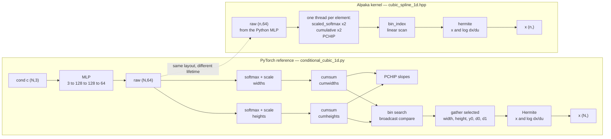
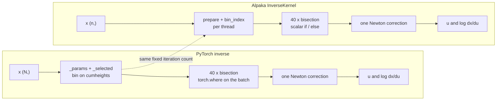

# Code comparison — PyTorch reference vs Alpaka kernel

This document maps the **marginal** of the upstream conditional normalizing
flow onto the Alpaka kernel in this repository. It is a reading guide, not a
second specification: the frozen interface is
[`docs/INTERFACE_CONTRACT.md`](INTERFACE_CONTRACT.md).

| side | file |
|---|---|
| PyTorch reference | `conditional-nf-integration/nf/conditional_linear_1d.py` and `conditional_cubic_1d.py` |
| Alpaka kernel | [`include/kernels/cubic_spline_1d.hpp`](../include/kernels/cubic_spline_1d.hpp) |
| launcher / dispatch | [`src/launcher.cu`](../src/launcher.cu) |
| Python boundary | [`src/bindings.cpp`](../src/bindings.cpp) |

The one-sentence version: **the mathematics is the same; the execution model is
not.** PyTorch composes the spline from dozens of tensor operations, so every
stage allocates an intermediate and pays a kernel launch. Alpaka gives one
thread one element, keeps every intermediate in registers/local arrays, and
runs the whole chain in a single launch.

## Scope

The comparison covers the **spline map only**. Three things deliberately stay
in Python:

1. the conditioning MLP (`3 → 128 → 128 → 2·n_bins`),
2. the autoregressive copula,
3. training and random-number generation.

The contract therefore starts at `raw`, the MLP's output, and ends at
`x`, `u` and `log |dx/du|`.

---

## 1. The two workflows, side by side

At a glance, without a renderer:

```text
PyTorch reference (per call)                 Alpaka kernel (per call)
─────────────────────────────                ────────────────────────
cond ─► MLP ─► raw                           raw ─┐
                 │                                │  one thread per element
        softmax(widths)  softmax(heights)         ▼
                 │              │             scaled_softmax ×2
              cumsum         cumsum                 │
                 │              │             cumulative ×2
              PCHIP          PCHIP                 │
                 └──────┬───────┘             knot_derivatives
                    bin search                      │
                        │                      bin_index
                     gather                         │
                        │                       hermite
                     Hermite                        │
                        │                           ▼
                 x, log|dx/du|                x, log|dx/du|

each box is a tensor op / launch             everything is one launch
```

The same thing as a diagram (GitHub renders Mermaid in Markdown):



**Figure 1.** Forward map. The arrows inside the PyTorch subgraph are separate
tensor operations; inside the Alpaka subgraph they are statements in one
thread. The dashed arrow is the interface: both sides consume the same
`(n, 2·n_bins)` array.

For the inverse, the difference is sharper because PyTorch's `torch.where`
cannot branch per element:



**Figure 2.** Inverse map. Both sides run the same 40 bisection steps followed
by one Newton correction, so the result is deterministic and seed-free. The
difference is that PyTorch evaluates every `where` on the whole batch, while
the kernel branches in one thread.

---

## 2. Explanation, stage by stage

| stage | PyTorch reference | Alpaka kernel | consequence |
|---|---|---|---|
| parameters | `self.net(cond)` inside `_params` | `raw` arrives as `(n, 2·n_bins)` | the MLP stays in Python; the kernel owns only the spline |
| storage | tensors `(N, n_bins)` and `(N, n_bins+1)` | fixed per-thread arrays `T width[N_BINS]`, `cumw[N_BINS+1]`, … | no global intermediates; `N_BINS` must be a template parameter |
| softmax | `F.softmax` | `scaled_softmax` with explicit max subtraction | same value; the subtraction is what keeps it stable |
| cumulative knots | `cumsum` + `pad` + force last knot to 1 | loop + `cum[N_BINS] = 1` | same convention, including the forced boundary |
| PCHIP slopes | sliced tensor arithmetic | loop over bins | same formula; positive secants still give positive slopes |
| bin search | `(value >= knots).sum(-1).clamp_max(N-1)` | `bin_index`, a linear scan | same index; the scan is cheap because all bins are local |
| selected bin | `gather` over tensors | direct `width[idx]` | removes a kernel launch and a gather |
| forward | vectorized Hermite | scalar Hermite per thread | same arithmetic |
| inverse | 40 iterations of `torch.where` on the batch, then Newton | 40 scalar `if/else` iterations, then Newton | same result; scalar branches replace tensor masks |
| precision | dtype of the tensors | `dispatch_precision` instantiates `float` and `double` | one build serves both dtypes |
| backend | `device` chosen by torch | `dispatch_backend` selects serial, OpenMP or CUDA | explicit; an unavailable backend raises instead of falling back |
| launch count | one or more per tensor op | one `alpaka::exec` per call | this is the measured 12–254× on the inverse |
| memory | new tensor per operation | `allocBuf` for in/out; `ViewPlainPtr` over caller memory | fewer copies; the remaining host-to-device copy of `raw` is the known gap |
| validation | Python raises on range and dtype | bindings validate shape, dtype, contiguity, backend | the same contract is enforced at the boundary |
| autograd | yes | no | the kernel is inference-only; training stays in PyTorch |

---

## 3. Code, side by side

The excerpts are verbatim but trimmed: comments and validation are removed
where they do not change the comparison. The full files are linked at the top.

### 3.1 Parameters: softmax, scaling and cumulative knots

<table>
<tr><th align="left">PyTorch — <code>_params</code></th><th align="left">Alpaka — <code>scaled_softmax</code> + <code>cumulative</code></th></tr>
<tr>
<td><pre><code>def _params(self, cond: Tensor) -&gt; tuple[Tensor, Tensor, Tensor, Tensor]:
    raw_widths, raw_heights = self.net(cond).chunk(2, dim=-1)
    widths = self.min_bin_width + (1 - self.n_bins * self.min_bin_width) * F.softmax(raw_widths, -1)
    heights = self.min_bin_height + (1 - self.n_bins * self.min_bin_height) * F.softmax(raw_heights, -1)
    cumwidths = F.pad(widths.cumsum(-1), (1, 0))
    cumheights = F.pad(heights.cumsum(-1), (1, 0))
    # Avoid accumulated softmax roundoff at the right boundary.
    cumwidths = torch.cat((cumwidths[:, :-1], torch.ones_like(cumwidths[:, -1:])), -1)
    cumheights = torch.cat((cumheights[:, :-1], torch.ones_like(cumheights[:, -1:])), -1)
    return widths, heights, cumwidths, cumheights</code></pre></td>
<td><pre><code>template&lt;typename T, int N_BINS&gt;
ALPAKA_FN_ACC inline void scaled_softmax(T const* logits, T min_bin, T* out)
{
    T max_logit = logits[0];
    for(int i = 1; i &lt; N_BINS; ++i)
        max_logit = logits[i] &gt; max_logit ? logits[i] : max_logit;

    T sum = T(0);
    for(int i = 0; i &lt; N_BINS; ++i)
        sum += std::exp(logits[i] - max_logit);

    T const room = T(1) - T(N_BINS) * min_bin;
    for(int i = 0; i &lt; N_BINS; ++i)
        out[i] = min_bin + room * (std::exp(logits[i] - max_logit) / sum);
}

template&lt;typename T, int N_BINS&gt;
ALPAKA_FN_ACC inline void cumulative(T const* bins, T* cum)
{
    cum[0] = T(0);
    for(int i = 0; i &lt; N_BINS; ++i)
        cum[i + 1] = cum[i] + bins[i];
    cum[N_BINS] = T(1);
}</code></pre></td>
</tr>
</table>

The reference computes `net(cond)` and splits it into width and height logits.
The kernel receives those logits as `raw` and runs the same two softmaxes per
thread. `cum[N_BINS] = 1` is not an optimisation; it matches the reference's
deliberate overwrite of the last cumulative knot, which removes accumulated
softmax roundoff at the right boundary.

### 3.2 PCHIP knot slopes

<table>
<tr><th align="left">PyTorch — <code>_derivatives</code></th><th align="left">Alpaka — <code>knot_derivatives</code></th></tr>
<tr>
<td><pre><code>@staticmethod
def _derivatives(widths: Tensor, heights: Tensor) -&gt; Tensor:
    """PCHIP knot slopes; these preserve monotonicity for positive secants."""
    secants = heights / widths
    if secants.shape[1] == 1:
        return torch.cat((secants, secants), dim=-1)
    left_w, right_w = widths[:, :-1], widths[:, 1:]
    weight1 = 2 * right_w + left_w
    weight2 = right_w + 2 * left_w
    interior = (weight1 + weight2) / (weight1 / secants[:, :-1] + weight2 / secants[:, 1:])
    return torch.cat((secants[:, :1], interior, secants[:, -1:]), dim=-1)</code></pre></td>
<td><pre><code>template&lt;typename T, int N_BINS&gt;
ALPAKA_FN_ACC inline void knot_derivatives(T const* width, T const* height, T* d)
{
    T secant[N_BINS];
    for(int i = 0; i &lt; N_BINS; ++i)
        secant[i] = height[i] / width[i];

    if constexpr(N_BINS == 1)
    {
        d[0] = secant[0];
        d[1] = secant[0];
    }
    else
    {
        d[0] = secant[0];
        d[N_BINS] = secant[N_BINS - 1];
        for(int k = 1; k &lt; N_BINS; ++k)
        {
            T const left = width[k - 1];
            T const right = width[k];
            T const w1 = T(2) * right + left;
            T const w2 = right + T(2) * left;
            d[k] = (w1 + w2) / (w1 / secant[k - 1] + w2 / secant[k]);
        }
    }
}</code></pre></td>
</tr>
</table>

The formulas are identical. The Python version uses slices to avoid a loop;
the kernel uses a fixed-size loop because `N_BINS` is known at compile time.
Both set the endpoint slopes to the adjacent secants, which is what makes the
map monotone.

### 3.3 The Hermite polynomial

<table>
<tr><th align="left">PyTorch — <code>_hermite</code></th><th align="left">Alpaka — <code>hermite</code></th></tr>
<tr>
<td><pre><code>@staticmethod
def _hermite(t: Tensor, y0: Tensor, height: Tensor, width: Tensor, d0: Tensor, d1: Tensor) -&gt; tuple[Tensor, Tensor]:
    t2, t3 = t * t, t * t * t
    x = ((2 * t3 - 3 * t2 + 1) * y0 + (t3 - 2 * t2 + t) * width * d0
         + (-2 * t3 + 3 * t2) * (y0 + height) + (t3 - t2) * width * d1)
    dx_dt = ((6 * t2 - 6 * t) * y0 + (3 * t2 - 4 * t + 1) * width * d0
             + (-6 * t2 + 6 * t) * (y0 + height) + (3 * t2 - 2 * t) * width * d1)
    return x, dx_dt</code></pre></td>
<td><pre><code>template&lt;typename T&gt;
ALPAKA_FN_ACC inline void hermite(
    T t,
    T y0,
    T height,
    T width,
    T d0,
    T d1,
    T&amp; x,
    T&amp; dxdt)
{
    T const t2 = t * t;
    T const t3 = t2 * t;
    x = (T(2) * t3 - T(3) * t2 + T(1)) * y0 + (t3 - T(2) * t2 + t) * width * d0
        + (-T(2) * t3 + T(3) * t2) * (y0 + height) + (t3 - t2) * width * d1;
    dxdt = (T(6) * t2 - T(6) * t) * y0 + (T(3) * t2 - T(4) * t + T(1)) * width * d0
           + (-T(6) * t2 + T(6) * t) * (y0 + height) + (T(3) * t2 - T(2) * t) * width * d1;
}</code></pre></td>
</tr>
</table>

Same polynomial and same derivative, term for term. The C++ version returns
both through references instead of a tuple, so it allocates nothing.

### 3.4 Forward: select a bin, then evaluate

<table>
<tr><th align="left">PyTorch — <code>forward</code></th><th align="left">Alpaka — <code>ForwardKernel</code> body</th></tr>
<tr>
<td><pre><code>def forward(self, u: Tensor, cond: Tensor) -&gt; tuple[Tensor, Tensor]:
    u, cond, column = self._values_and_cond(u, cond)
    if torch.any((u &lt; 0) | (u &gt; 1)):
        raise ValueError("u must lie in [0, 1]")
    width, height, u0, x0, d0, d1 = self._selected(u, cond, inverse=False)
    t = ((u - u0) / width).clamp(0, 1)
    x, dx_dt = self._hermite(t, x0, height, width, d0, d1)
    logabsdet = torch.log(dx_dt.clamp_min(torch.finfo(dx_dt.dtype).tiny)) - torch.log(width)
    return self._restore(x, column), logabsdet</code></pre></td>
<td><pre><code>// Preceded by per-thread arrays and prepare(raw, ...), which build
// width, height, cumw, cumh and d for this element.
T const value = u[i];
int const idx = bin_index&lt;T, N_BINS&gt;(value, cumw);
T const w = width[idx];
T const h = height[idx];
T const y0 = cumh[idx];

T const t = clamp01((value - cumw[idx]) / w);

T xv = T(0);
T dxdt = T(0);
hermite(t, y0, h, w, d[idx], d[idx + 1], xv, dxdt);

x[i] = xv;
logabsdet[i] = std::log(dxdt &gt; tiny&lt;T&gt;() ? dxdt : tiny&lt;T&gt;()) - std::log(w);</code></pre></td>
</tr>
</table>

The Python stage does its selection work in `_selected`: it broadcasts the
value against every knot, sums the comparison, then gathers five tensors. The
kernel already has all bins in local arrays, so the selection collapses to
`bin_index` plus five array reads. Everything else — the clamp of `t`, the
Hermite call, the `log(dx/dt) - log(width)` — is the same expression.

### 3.5 Inverse: bisection plus one Newton step

<table>
<tr><th align="left">PyTorch — <code>inverse</code></th><th align="left">Alpaka — <code>InverseKernel</code> body</th></tr>
<tr>
<td><pre><code>def inverse(self, x: Tensor, cond: Tensor) -&gt; tuple[Tensor, Tensor]:
    x, cond, column = self._values_and_cond(x, cond)
    if torch.any((x &lt; 0) | (x &gt; 1)):
        raise ValueError("x must lie in [0, 1]")
    width, height, u0, x0, d0, d1 = self._selected(x, cond, inverse=True)
    low, high = torch.zeros_like(x), torch.ones_like(x)
    for _ in range(self.inverse_iterations):
        mid = (low + high) * 0.5
        x_mid, _ = self._hermite(mid, x0, height, width, d0, d1)
        low = torch.where(x_mid &lt; x, mid, low)
        high = torch.where(x_mid &lt; x, high, mid)
    t = (low + high) * 0.5
    # One Newton correction makes autograd follow the implicit root, while
    # bisection supplies the globally safe initial value.
    x_t, dx_dt = self._hermite(t, x0, height, width, d0, d1)
    t = (t - (x_t - x) / dx_dt.clamp_min(torch.finfo(x.dtype).tiny)).clamp(0, 1)
    _, dx_dt = self._hermite(t, x0, height, width, d0, d1)
    u = u0 + width * t
    u = u.clamp(0.0,1.0,)
    logabsdet = torch.log(dx_dt.clamp_min(torch.finfo(dx_dt.dtype).tiny)) - torch.log(width)
    return self._restore(u, column), logabsdet</code></pre></td>
<td><pre><code>// Preceded by the same per-thread prepare(...) as the forward.
T const target = x[i];
int const idx = bin_index&lt;T, N_BINS&gt;(target, cumh);
T const w = width[idx];
T const h = height[idx];
T const y0 = cumh[idx];
T const u0 = cumw[idx];

T low = T(0);
T high = T(1);
for(int iteration = 0; iteration &lt; inverse_iterations; ++iteration)
{
    T const mid = (low + high) * T(0.5);
    T xmid = T(0);
    T dxmid = T(0);
    hermite(mid, y0, h, w, d[idx], d[idx + 1], xmid, dxmid);
    if(xmid &lt; target)
        low = mid;
    else
        high = mid;
}

T t = (low + high) * T(0.5);

T xt = T(0);
T dxt = T(0);
hermite(t, y0, h, w, d[idx], d[idx + 1], xt, dxt);
T const safe_dx = dxt &gt; tiny&lt;T&gt;() ? dxt : tiny&lt;T&gt;();
t = clamp01(t - (xt - target) / safe_dx);

T dummy = T(0);
T dxdt = T(0);
hermite(t, y0, h, w, d[idx], d[idx + 1], dummy, dxdt);

T mapped = u0 + w * t;
u[i] = clamp01(mapped);
logabsdet[i] = std::log(dxdt &gt; tiny&lt;T&gt;() ? dxdt : tiny&lt;T&gt;()) - std::log(w);</code></pre></td>
</tr>
</table>

This is the largest structural difference. PyTorch cannot branch per element,
so each of the 40 bisection iterations builds a full-batch `mid` tensor, calls
`_hermite` on it, and updates `low`/`high` with `torch.where`. The kernel does
the same arithmetic with two scalars in one thread. The iteration count is a
runtime field in `SplineSpec` (`inverse_iterations`, fixed at the default 40 by
the Python binding), so it can be changed without recompiling the kernel.

### 3.6 The call boundary

The Python call loses `cond` and gains `raw` and an explicit backend:

```python
# upstream reference
x, logdet = model.forward(u, cond)

# this repository
x, logdet = mango.forward(raw, u, backend="cuda")
```

Behind the binding, the whole call is one C++ function:

```cpp
void cubic_spline_forward(
    Backend backend,
    const void* raw,
    const void* u,
    void* x,
    void* logabsdet,
    const SplineSpec& spec);
```

`bindings.cpp` validates shapes, dtypes and contiguity; `launcher.cu` selects
the backend, precision and bin count, copies `raw` and the input values to the
device, launches one kernel, and copies the two outputs back. The kernel itself
never sees `cond`, a tensor library, or a Python object.

The three contract names are thin wrappers over the two primitives:

| contract call | built from |
|---|---|
| `sample(raw, u)` | `forward(raw, u)` — return the value |
| `log_density(raw, x)` | `inverse(raw, x)` — return `-logabsdet` (uniform base) |
| `sample_and_log_prob(raw, u)` | `forward(raw, u)` — return both outputs |

---

## 4. What is deliberately not a port

| item | where it stays | why |
|---|---|---|
| conditioning MLP | PyTorch | architecture is Brown's to change; the contract must not depend on it |
| autoregressive copula | PyTorch | the kernel covers one marginal, not the joint model |
| training / autograd | PyTorch | the kernel is an inference path; no backward pass is implemented |
| random draws | Python | `sample` takes `u` from the caller, so the RNG stays outside the kernel |
| tensor validation | `bindings.cpp` | a Python-facing boundary should raise Python-friendly errors |

This is why the kernel takes `raw`, not `cond`: the interface survives a change
of conditioning network, which is exactly what the MANGO workstream expects
from Brown's side.

---

## 5. Correspondence table

| Python | C++ | note |
|---|---|---|
| `ConditionalLinearFlow1D._params` | `scaled_softmax`, `cumulative`, `prepare` | the MLP call is removed; the rest is identical |
| `ConditionalCubicFlow1D._derivatives` | `knot_derivatives` | PCHIP slopes |
| `ConditionalCubicFlow1D._hermite` | `hermite` | polynomial and derivative |
| `ConditionalCubicFlow1D._selected` | `bin_index` + direct indexing | no gather |
| `ConditionalCubicFlow1D.forward` | `ForwardKernel` | one thread per element |
| `ConditionalCubicFlow1D.inverse` | `InverseKernel` | bisection + Newton |
| torch dtype dispatch | `dispatch_precision` | `float32` / `float64` |
| torch device selection | `dispatch_backend` | serial / OpenMP / CUDA |
| `model.forward(u, cond)` | `mango.forward(raw, u, backend=...)` | the contract boundary |

---

## 6. What stays identical

The formulas, the forced last knot, the PCHIP endpoint rule, the 40-step
bisection, the single Newton correction, the `clamp_min(tiny)` guard on the
log-Jacobian, the uniform-base identity `log q(x) = -log |dx/du|`, and the
`[0,1]` domain are all unchanged. The parity tests in
`tests/test_cubic_spline_parity.py` check exactly this: 26 tests, 13 per
precision, at `1e-12` in `float64` and a measured `2e-5` in `float32`.
